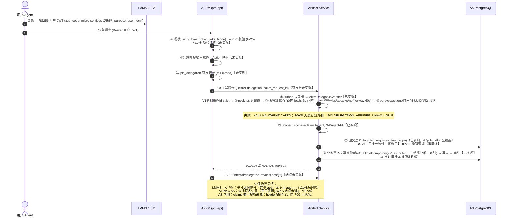

# WP-LMMS-DELEGATION-02 — SECURITY-ARCHITECTURE（安全模型独立审查）

| | |
|---|---|
| 状态 | R2 独立安全评审交付（2026-11-25）。本文为 R2 的独立分析，不复述契约；与契约冲突处以本文为准并记入 FINDINGS。 |

## 1. 安全模型十问（独立回答）

| # | 问题 | R2 独立回答 | 证据/缺口 |
|---|---|---|---|
| 1 | 谁是最终授权主体？ | delegation `sub` 所指的 LMMS 用户（经 AI-PM 内部 principal 映射）；AS 执行的每次动作都归属于该主体 + (tenant_id, project_id) scope。`actor_type` 缺省=User（`ai_pm.rs:127-137`），agent/service 需显式声明且仍以 sub 为归属 | 设计成立 |
| 2 | 谁可以请求签发 Delegation？ | 设计上：仅通过 §3.0 七项验证链的人类 principal 的受控业务意图接口；**实现上：无人可以——签发接口不存在**（AI-PM 零实现） | R2-F-05 |
| 3 | 谁负责判断业务意图合法性？ | AI-PM（意图→Action 映射为服务端常量 + DB 成员关系/业务状态判定）；AS 不解释角色（Q2/红线 3）。设计职责正确 | 实现缺席（阶段 1） |
| 4 | 谁负责验证 Token？ | AS 的 `AiPmDelegationVerifier`（RS256 + JWKS + V1–V9 全部落地）；签发侧自验证链（§3.0）属 AI-PM | AS 侧已实现并独立复测 |
| 5 | 谁负责撤销 Token？ | AI-PM（存储+端点），AS 写路径在线消费。**两侧均未实现**，端口存在零接线 | R2-F-02 |
| 6 | 谁负责校验请求与授权目标一致？ | AS（V10：绑定 claim vs 请求目标）。**未实现**：`assert_delegation_matches_request` 零调用点 | R2-F-01 |
| 7 | 身份混淆/提权/跨租户？ | 跨租户：tenant 恒取凭证（`auth.rs:93`），repo 全部以 (tenant, project) 谓词过滤，s10 验证 404 不泄露——**成立**。动作提升：写路径经 `require`——**成立**；三个读端点绕过动作检查——**违反 Q3**（scope 内读越权）| R2-F-03 |
| 8 | Confused deputy？ | AS 无自主意志：全部授权输入来自凭证 claims（受信签名）+ 路径/头（仅定位）。`lmms_tid` 明确不参与授权（`action.rs:92`、`ai_pm.rs:73-75`）——**无 deputy 面**。残余：AS 对"签发方签名正确但签发决策错误"无防御（设计如此，信任 AI-PM） | 设计成立 |
| 9 | 重放/竞态/TOCTOU？ | 并发重放：绑定表（未接线）或业务幂等（AS-1/AS-2 已存在且并发测试通过）仲裁。TOCTOU：授权→写入之间的撤销窗口=Q1 未接线前的 TTL 全窗（≤300s，知情残留）；`create_artifact` 无幂等键 + 无绑定字段 + 未接线 V10 时 TTL 内可重复创建（见 O-5 分析）。授权失败部分写入：`require` 前置于一切写入（artifact.rs:97 等 13 处逐点核对），失败路径无写入 | O-5 分析、R2-F-01/02 |
| 10 | 单侧不可用 fail-closed？ | AI-PM JWKS 断供：空缓存/超 15min 陈旧 → 503 `DELEGATION_VERIFIER_UNAVAILABLE`（s06 实测）✓。AI-PM 整体停机：验证段在 JWKS 缓存 15min 窗口内**仍可验签放行**（Q5 设计容忍）；撤销段未接线 → 写平面既不放行也不 fail-closed（**闭环语义未生效**）；AS 停机：AI-PM 侧客户端不存在（无从验证）| R2-F-02、RELEASE-GATE G6 |

## 2. 实际调用链（R2 版：标注实现状态）

### 事务边界（AS 侧，已核对源码）

| 步骤 | 事务 | 说明 |
|---|---|---|
| ①–⑥ 验证 | 无 DB 事务 | 纯进程内 + JWKS 出站；失败无副作用 |
| ⑦ require | 无 DB 事务 | 进程内判定；失败 403，无写入 |
| ⑧ keyed create | 单事务（`PgKeyedArtifactCreator`） | 幂等解析+插入+身份写入原子（AS-1） |
| ⑧ unkeyed create | 幂等 reserve（事务1）→ insert（事务2）→ complete（事务3） | 三段非原子；失败以错误码收尾幂等记录（artifact.rs:164-180） |
| ⑧ patch | 乐观锁 If-Match | 版本冲突 409，无丢更新 |
| 绑定 consume | 独立事务（未接线） | `INSERT ON CONFLICT` + `FOR UPDATE` 重判（s13/s14 验证） |

## 3. 信任边界清单（R2 确认）

1. **LMMS → AI-PM**（用户身份）：RS256 平台 JWKS；共享 aud 无专用受众（契约已声明为残余风险，属 LMMS 后续需求）。AI-PM 现状连 aud 都不校验（F-25）——签发链启用前必须修复。
2. **AI-PM → AS**（委托凭证）：专用签名密钥（规划）+ 固定 aud + purpose 双闸；AS 侧 pin 在"配置固定 URL + https + 禁重定向 + kid-strict + 15min 陈旧上限"。**PoC 证实 audience 可被配置覆盖**（R2-F-06）——固定值目前是默认值而非不变量。
3. **AS 内部**：claims 是唯一授权来源；`X-Project-Id`/body 仅定位（Q2 落实正确，`auth.rs:93-96` + `Delegation::require`）。
4. **AS → DB**：运行角色无 DDL；migrate 子命令独立；迁移 0001–0005 不动、0006 仅追加（sha256 清单校验）。
5. **Worker 面**：`artifact-worker` 无 HTTP server（grep 证实），DB 角色直连 + lease——**不存在绕过授权中间件的 worker 写入面**。

## 4. R2 独立结论

AS 验证段（V1–V9 + fail-closed 姿态）**设计正确、实现质量高、防御真实**；授权闭环的"执行侧两闸"（V10 目标一致性、V11 在线撤销）与"签发侧全部"（AI-PM）缺失，闭环不成立。模型本身（候选 B）经 R2 重新推演后**仍然成立**：R1 的候选 B 裁决无需推翻；需要推翻/修订的是两处外围裁决建议——O-5（AS 加表）与 O-6（request_hash 无版本化即保留），见 [O5-O6-DECISIONS](O5-O6-DECISIONS.md)。
