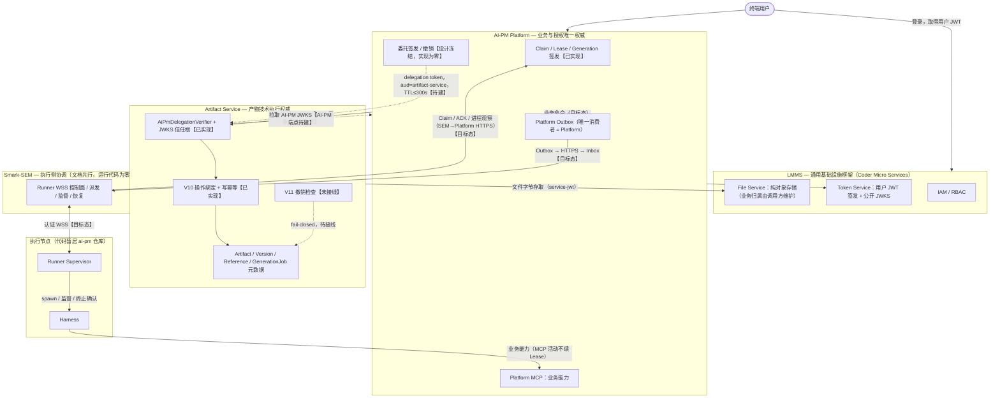

# WP-LMMS-DELEGATION-RECLASSIFICATION-01 — 跨仓库职责归属审计报告

| 项 | 值 |
|---|---|
| 任务 | WP-LMMS-DELEGATION-RECLASSIFICATION-01 · 跨仓库职责归属审计与修订方案 |
| 审计日期 | 2026-11-26 |
| 性质 | **只读审计**（未修改任何仓库既有文件；未创建/合并/关闭 PR；未删除任何分支或文件；唯一新增物即本报告） |
| 审计范围 | smark-artifact-service / ai-pm / lmms / smark-sem 四仓库的全部本地分支、远端分支（`git ls-remote`）、PR head 引用、提交历史、文档与源码 |
| 审计时各仓基线 | 见 §A |
| 本报告位置 | `smark-artifact-service` @ 分支 `docs/wp-lmms-delegation-reclassification-01`（基于 `main` = `b5095cf4`） |

## 专家快速导航

1. **定位结论**：WP-LMMS-DELEGATION-01～04 的全部成果位于 smark-artifact-service 仓库（外加 ai-pm 仓库 1 个文档分支/PR #11 DRAFT）。LMMS 与 smark-sem 仓库**零成果**（全关键词 NOT FOUND）。
2. **命名纠偏**：系列名中的 "LMMS" 是误导——实际协议是「AI-PM 签发委托 token → AS 以 JWKS 验签并强制绑定」；契约红线 4 明文「LMMS 不参与委托链路」。
3. **归属裁决**：AS 侧已实现成果全部 KEEP（验证器/V10 绑定/幂等/R1 query 拒绝）；**没有任何内容需要迁往 SEM**；AI-PM 侧签发/撤销/PC-O6-3 实现责任全为零（关键路径）；LMMS 两个 P0 缺陷修复责任在 lmms 仓库。
4. **安全现状**：AS 生产姿态 fail-closed（空 issuer 全拒）——安全的，因为 AI-PM 签发侧零实现、世上尚无有效委托 token；V11 撤销闭环两端缺失，被 RELEASE-GATE G2 阻断。
5. **未决 BLOCKED 项**：D1（W1–W8 operation_id 语法）、D4（W8 artifact_id 缺省拒绝）、GenerationJob 执行体协议、SEM PR #2 架构方向分歧。
6. **需要决断的行动项**：推送两个本地-only 分支（`docs/wp-lmms-delegation-02-review`@`94d22a1`、`fix/wp-lmms-delegation-04-r1`@`b40bc9d`）消除单副本风险——本报告推送不含这两个分支。

---

## A. 审计基线

| 仓库 | 远端 | 本地路径 | 检出分支 | HEAD SHA | 工作树状态 |
|---|---|---|---|---|---|
| smark-artifact-service（AS） | `github.com/luqizheng/smark-artifact-service` | `C:\projects\smark-artifact-service` | `feat/wp-lmms-delegation-03-as-remediation` | `8fd5173061f935513246b952195e88cea39e8515` | 未跟踪 `docs/security/WP-LMMS-DELEGATION-02/`（**仅 PoC `target/` 构建残渣，见 B-7**） |
| ai-pm | origin=`192.168.2.16:tooling/ai-pm.git`（Gitea，默认分支 **master**）＋ github 镜像 | `C:\projects\ai-pm` | `docs/wp-lmms-delegation-01` | `6f101ce9fb99eabe3a11d41bc13662704e129acb` | 未跟踪 `.workbuddy/memory/2026-11-25.md`（本地笔记） |
| lmms | origin=`192.168.2.16:template/low-memory-micro-services.git` | `C:\projects\lmms` | `main` | `92691f3313800cc973451e7ca8259753cda666f0` | 干净 |
| smark-sem | `github.com/luqizheng/smark-sem` | 本地原不存在；审计用临时只读克隆 `C:\projects\smark-sem-audit-readonly` | `main` | `344a9dad26666a1989cf13a79b839736c7ca0e38` | 干净（克隆） |

AS 另有 2 个链接工作树：`C:\projects\smark-as-wp04`（`feat/wp-lmms-delegation-04-operation-binding` @ `d6258e9`）、`C:\projects\smark-as-wp04-r1`（`fix/wp-lmms-delegation-04-r1` @ `b40bc9d`）。

**验证缺口声明**：审计环境到 `api.github.com`/`github.com` 的 HTTPS 不通（仅 SSH git 可用），故 AS 仓库 PR #12/#14/#15 的 **Draft/Open 状态与 CI 结论无法经 API 复核**，仅 head 引用经 `git ls-remote origin 'refs/pull/*/head'` 证实；AI-PM 的 PR #11（Gitea）已经 `gh` 确认为 DRAFT。

---

## B. 旧 WP-01～04 定位结果

### B-1 核心结论

**WP-LMMS-DELEGATION-01～04 的全部成果位于 smark-artifact-service 仓库（外加 ai-pm 仓库的 1 个配套文档分支）。LMMS 仓库与 smark-sem 仓库零成果**——两仓全分支检索 `delegation / ClosedDelegationVerifier / AiPmDelegationVerifier / request_hash / artifact_id / WP-LMMS`：LMMS 全部 NOT FOUND（`delegation` 0 命中），SEM 全部 NOT FOUND（仅其自有 `dispatch_operation.operation_id` 表主键与一份无关的 Harness 委托草案）。

**系列名中的 "LMMS" 是误导性命名**：实际协议是「AI-PM 签发委托 token → AS 验签并强制绑定」，契约红线 4 明文「LMMS 不参与委托链路」，LMMS 只是被动身份源（用户 JWT + JWKS）与文件字节存储方。

### B-2 分支链（AS 仓库，全部未并入 `origin/main` = `b5095cf4`，已逐提交验证）

```
main b5095cf ─┬─ WP-01  docs/wp-lmms-delegation-01        @ 40848f18  (b8fa97b→26a37f3→40848f1)  [已推送, PR #12]
              │     ├─ WP-02  docs/wp-lmms-delegation-02-review @ 94d22a18 (+94d22a1)  [仅本地, 无 PR]
              │     └─ WP-03  feat/wp-lmms-delegation-03-as-remediation @ 8fd51730 (+8fd5173)  [已推送, PR #14]
              │           └─ WP-04  feat/wp-lmms-delegation-04-operation-binding @ d6258e93
              │                 (e3bc3ba→7e140af→7fd9360→8f59c97→d6258e9)  [已推送, PR #15]
              │                       └─ WP-04-R1  fix/wp-lmms-delegation-04-r1 @ b40bc9d54
              │                             (d3241c0→bd07770→eeccc1d→e73cd5b→c4cb611→b40bc9d)  [仅本地, 无 PR]
ai-pm master 6f317176 ── WP-01(AI-PM 侧)  docs/wp-lmms-delegation-01 @ 6f101ce9
                            (556d678→b291bf4→6f101ce, 仅 1 个文档文件)  [Gitea PR #11 DRAFT（已验证）]
```

这是一条**链式堆叠栈**：WP-02 与 WP-03 都基于 WP-01 tip；WP-04 基于 WP-03 tip；R1 基于 WP-04 tip。合并顺序被链条固定。

### B-3 逐项定位表

| 对象 | 真实归属 | PR | 提交 | 当前状态 |
|---|---|---|---|---|
| WP-01（审计+契约+安全评审+实施计划+验证器实现） | AS `docs/architecture/WP-LMMS-DELEGATION-01-*.md` + 验证器代码 | GitHub PR #12（head `40848f18` 存在已证实；Draft 状态未验证） | `b8fa97b` `26a37f3` `40848f1` | 未合并；AS 侧已实现+有测试 |
| WP-01 配套（AI-PM 集成说明，61 行单文件） | ai-pm `docs/architecture/WP-LMMS-DELEGATION-01-AI-PM-INTEGRATION.md` | Gitea PR #11 **DRAFT**（已验证） | `556d678` `b291bf4` `6f101ce` | 未合并；纯文档，AI-PM 代码零改动 |
| WP-02（R2 独立评审：CONDITIONAL PASS，5 P1+10 P2，O-5 移除/O-6 修订保留） | AS 分支 `docs/wp-lmms-delegation-02-review` | **无 PR** | `94d22a1` | 未合并；**仅本地单副本**（未推送） |
| WP-03（契约 v0.3、O-5 删除落地、O-6 request_hash v1+冻结向量、audience 钉死、读 handler 修复） | AS `docs/security/WP-LMMS-DELEGATION-03/` + 代码 | PR #14（head `8fd5173`） | `8fd5173` | 未合并；已实现+21 项新测试 |
| WP-04（V10 操作绑定接线 9 写路由+幂等+adversarial 套件+路由矩阵） | AS `docs/security/WP-LMMS-DELEGATION-04/` + `operation_binding.rs` 等 | PR #15（head `d6258e9`）**存在已证实** | `e3bc3ba` `7e140af` `7fd9360` `8f59c97` `d6258e9` | 未合并；已实现+29 例测试；TEST-EVIDENCE 记载 PR #15 CI 绿（本轮未复核） |
| WP-04-R1（query 拒绝+W8 目标绑定修正+D1 计数 7→8） | AS 分支 `fix/wp-lmms-delegation-04-r1` | **无 PR** | `d3241c0` `bd07770` `eeccc1d` `e73cd5b` `c4cb611` `b40bc9d` | 未合并；**仅本地单副本**；本地 282 测试过、CI 未运行 |
| commit `d6258e933239966878efff0e4c5ac207c40956a8` | AS，"docs(security): WP-04 test evidence with CI results"，2026-11-26 11:28+08 | = PR #15 head | 已推送 | ✅ 定位 |
| commit `b40bc9d541894942a1c61fbaaa2ca68af7296d99` | AS，"docs(security): correct WP-04 D1 route count"，2026-11-26 12:28+08 | R1 分支 tip，仅本地 | 未推送 | ✅ 定位 |
| 分支 `fix/wp-lmms-delegation-04-r1` | AS 本地 worktree `C:\projects\smark-as-wp04-r1` | 无 upstream、无 PR | — | ✅ 定位 |

### B-4 无关项澄清

AS 仓库 PR #11（head `b68e075`，"docs(deploy): fix shell continuation in grants example"）与 WP 系列**无关**，勿与 ai-pm PR #11 混淆。

### B-5 四仓库关键词对照（定案）

| 关键词 | AS | ai-pm | lmms | smark-sem |
|---|---|---|---|---|
| `ClosedDelegationVerifier` | ✅ 代码+文档（fail-closed 默认验证器） | ✗ | ✗ | ✗ |
| `AiPmDelegationVerifier` | ✅ 代码+文档 | ✗（文档仅转述“验证器 V1–V9”） | ✗ | ✗ |
| `operation_id`（委托绑定 claim 语境） | ✅ 契约+代码（仅 W9 比对） | ⚠️ 同名异义（documents/command executor 幂等，KB-02） | ✗ | ⚠️ 同名异义（SEM `dispatch_operation` 表主键） |
| `artifact_id` | ✅（AS 实体+绑定 claim） | ✅（viz.artifact→AS 映射，ART-01/04B） | ✗（仅 Maven `<artifactId>`） | ✗ |
| `request_hash` | ✅（委托指纹+幂等 sha256 两个概念） | ✅（ART-01 Job 幂等语境） | ✗ | ✗ |
| `W1～W9`、`V10/V11`、`PC-O6-3` | ✅（见 §D） | ✗（`V11` 为无关编号碰撞；`PC-O6-3` NOT FOUND） | ✗ | ✗ |

### B-6 SEM 侧补充发现（影响后续架构，非 WP 成果）

smark-sem main 为**纯文档仓库**（0 行运行时代码；实现骨架仅在未合并 PR #1，+357 行 liveness-only Rust）；ADR-SEM-01～26 齐备，SEM-02J 审计 "Changes Required"、Phase 0 未启动；**5 个分支/PR 全部未合并**。未合并的 PR #2（`95b254a8`）提出「SEM = 不透明执行消息传输，取代 Protocol V1 的 Claim/Lease 模型」——一个**尚未裁决的架构方向分歧**。

### B-7 未跟踪目录真相（修正此前认知）

AS 主工作树的未跟踪 `docs/security/WP-LMMS-DELEGATION-02/` **不含任何文档**，只有 PoC 的 Rust `target/` 构建残渣（切分支时被 .gitignore 保留）。WP-02 的全部实质内容（7 个 md + PoC 源码）安全保存在分支 `94d22a1` 上。**没有丢失的工作**；但 WP-02 与 R1 两个分支本身仅存本地一份。

---

## C. 职责边界确认

| 系统 | 最终职责（本轮证据） | 权威性 | 当前实现状态 |
|---|---|---|---|
| **AI-PM（Platform）** | Project/Task/Run/Lease/Generation/HIR/业务命令/审计的**唯一权威**；Claim 事务内签发 Lease Token、递增 Generation（`ai-pm docs/architecture/server-execution-management/code-contract-mapping.md:34`、`state-machines.md:16-24`、ADR-SEM-19/20）；委托 token 唯一签发方与撤销权威（设计）；Harness 业务通道（Platform MCP） | 业务权威 + 委托授权权威 | Claim/Lease 已实现（`crates/pm-application/src/run_dispatch/claim.rs`）；**委托签发/撤销/JWKS 端点全部零实现**；SEM API/WSS 未实现 |
| **Smark-SEM** | Runner 连接认证、WSS 控制协议、派发协调（资源感知+原子预留）、进程监督与 OS 事实观察、SEM 本地七表持久化与恢复。**不是业务权威**：调度选择不构成执行权，必须等 Platform Claim 成功；禁止连 Platform PG；Outbox 单消费者=Platform；Runner 不得绕过 SEM | 执行侧协调权威（非授权权威） | **零运行代码**（main 纯文档；骨架在未合并 PR #1）；PR #2 方向分歧未裁决 |
| **LMMS** | 通用微服务基础设施框架（Coder Micro Services）：gateway/IAM/token(JWT+JWKS)/file/audit/notification/menu + 2 个 outbox publisher。**Worker=outbox 投递进程，与 Agent 执行无关**；File Service 只存字节，业务归属由业务服务维护（`file-storage-usage.md:148,180`）；无任何 delegation/agent/runner 概念（全仓 0 命中）；有公开 JWKS（`/.well-known/jwks.json`） | 无业务权威（明确禁止业务判断） | 框架成熟（v1.8.x）；WP-01 审计指控其 2 个 P0（`/tokens/resource` 未鉴权、用户 JWT 缺 aud/tid）——**本轮未独立复核，标注待复核** |
| **Runner** | 独立安装的执行节点客户端（非 SEM 子进程）：设备密钥、WSS 重连、本机 Harness spawn/监督/终止、资源采样、本地工作区；不得直接 Claim/轮询 Platform（CROSS-REPO §4） | 执行节点本地权威（进程/资源） | 代码暂居 ai-pm 仓库 `apps/ai-pm-runner`，抽取决策未做 |
| **Harness** | agent 执行器，被 Runner spawn；只经 Platform MCP 使用业务能力；不连 SEM；MCP 活动不续 Lease | 无独立权威 | 同上（ai-pm 仓库） |
| **Artifact Service（AS）** | AI-PM 的独立产物基础设施（ADR-ART-001）：Artifact/不可变 Version/Reference/GenerationJob 元数据与**技术执行权威**；「AI-PM is the business controller; AS is the technical execution authority」（`ART-04:16`）；唯一 API 调用方=AI-PM 后端（`crates/artifact-client` SDK） | 产物元数据/版本技术权威（非业务权威） | 验证器+V10 绑定+幂等已实现；**V11 未接线**；W3/W4/W8 写能力被 P0 阻断 503；生产姿态 fail-closed 全拒 |

**旧 WP 系列的两个系统性认知偏差**（本审计纠正的核心）：
1. **命名错误**：把「AI-PM→AS 委托」命名为 WP-**LMMS**-DELEGATION，而 LMMS 零参与；
2. **世界模型缺失**：旧系列的三服务模型（LMMS=身份与文件、AI-PM=业务授权、AS=通用执行）**完全遗漏了执行平面**（SEM/Runner/Harness）。旧成果与 SEM 域零交集、零冲突，但 GenerationJob 的**执行体协议**（谁真正执行生成任务）在所有仓库中均未定义。

---

## D. 旧成果归属矩阵

裁决图例：KEEP=保留 · REDEFINE=概念有效但需重定义/更名 · MOVE=应迁至正确仓库 · DEPRECATE=废弃 · BLOCKED=证据不足/待裁决

| 对象 | 当前位置（分支/SHA） | 当前状态 | 正确责任主体 | 裁决 | 理由与证据 |
|---|---|---|---|---|---|
| **W1～W9（9 条 v1 写路由）** | AS `feat/...-04-operation-binding`/R1；`ROUTE-IDEMPOTENCY-MATRIX.md:19-79`、`operation_binding.rs:56-75` | W1/W2/W5/W6/W7/W9 可用；W3/W4/W8 被 P0 阻断 503（StoragePort/generator 未接，属 ART-02 既有状态） | **AS 全部 9 条**（产物元数据管理面） | **KEEP** | 路由全属 AS 职责域，与 SEM 派发/LMMS 无关；绑定+幂等已实现且有 29+6 例测试 |
| **W9（cancelJob）** | 同上（仅 WP-04+ 分支存在；WP-03 分支 NOT FOUND） | 唯一落地 operation_id 精确比对（`generation_job:{job_id}`）的路由 | AS（GenerationJob 状态机取消） | **KEEP** | 三层取消语义不可混淆：AI-PM 业务 Run 取消（权威 AI-PM）≠ SEM/Runner 进程终止确认（执行域）≠ AS GenerationJob 取消（W9，技术域）。W9 只属第三层，无越权 |
| **V10（操作绑定验证）** | AS；WP-04 已接线（`enforce_write_binding`，9 写入口） | 已实现+测试+PR #15 CI 绿（文档记载） | AS（资源服务器强制点） | **KEEP** | 防 confused-deputy/跨目标重放，验证责任在持有资源的 AS，归属正确 |
| **V11（写路径撤销检查）** | AS：端口+FailClosed 存根（`port/revocation.rs`）**零生产消费**；AI-PM：撤销端点零实现 | 设计冻结、实现缺失（两端） | 撤销权威=AI-PM；执行检查点=AS | **KEEP（设计）+ 列入待办** | RELEASE-GATE G2 已将其列为生产开放阻断，门禁本身 KEEP；当前被 fail-closed（空 issuer 全拒）安全兜底 |
| **operation_id（token claim）** | AS 契约 §3.1.2 + `operation_binding.rs` | 绑定轴 claim；仅 W9 强制比对；W1–W8「存在时不比对」（D1 停止待裁决） | AI-PM 生成、AS 验证 | **KEEP（已冻结部分）；D1 提案 BLOCKED** | 与 SEM `dispatch_operation.operation_id` 同名异义，与 ai-pm documents `operation_id` 同名异义——需术语消歧 |
| **artifact_id（token claim）** | AS 契约 + 绑定轴 | 绑定轴（存在时与路径 ID 相等，D2 无目标路由 fail-closed 403）；非幂等键 | AS 创建/持久化；访问授权由 AI-PM 决定、AS 强制 | **KEEP** | AS 是 artifact 元数据权威（ADR-ART-001），归属正确；D4（W8 缺省是否拒绝）与冻结契约文本冲突 → BLOCKED |
| **request_hash** | AS：①委托指纹 `biz.request_hash`（v1 规范，重算比对）；②幂等 sha256（AS-1 idempotency 表） | ①形状+冻结向量已实现（未接 AI-PM 交叉验证）；②已实现 | ①AI-PM 同算法实现（PC-O6-3，零实现）+ AS 验证；②AS | **KEEP；PC-O6-3 → MOVE（AI-PM 工作项）** | 同词双义（指纹 vs 幂等哈希）建议更名区分；AS 侧冻结向量基准（`delegation_request.rs:222`）KEEP 且禁改 |
| **PC-O6-3（AI-PM 侧同算法+交叉向量）** | AS 文档记录 ⛔；AI-PM 零实现 | 阻断 | **AI-PM** | **MOVE**（责任移入 AI-PM 工作包） | AS 已备权威向量基准，缺的是签发方实现 |
| **ClosedDelegationVerifier**（默认全拒验证器） | AS `delegation/mod.rs:25-43`、装配 `state.rs:27-58` | 已实现+测试（s21/default_deny）；空 issuer 配置→全拒，无绕过开关 | AS | **KEEP** | fail-closed 默认是正确安全姿态 |
| **AiPmDelegationVerifier + JWKS 信任根** | AS `delegation/ai_pm.rs:258-428`、`jwks.rs`；aud 编译期钉死 `artifact-service` | 已实现（V1–V9 全链+PC-O5-1 红线）+测试 | AS 验证 / AI-PM 签发与 JWKS 提供 | **KEEP（AS 侧）；AI-PM 端点为待建** | 资源服务器验签放 AS 正确；LMMS 的 JWKS 不是信任根（信任根是 AI-PM 的）——与系列名暗示相反 |
| **授权与撤销机制** | 设计：AI-PM 唯一签发（Q6 冻结）+ 撤销表（`pm_delegation`/`pm_delegation_revocation`，jti 7 天）；AS 写前在线查询（pull） | AI-PM 全零实现；AS 检查未接线 | AI-PM（权威+执行）+ AS（检查点） | **KEEP（设计）+ 后续工作包** | 无重复权威；传播模型（pull+fail-closed）正确 |
| **文件与产物归属** | LMMS File Service 纯存储（`file-storage-usage.md:148`：业务记录只存 file ID）；AS 持 Artifact/Version 元数据 | 边界正确 | LMMS=字节存储；AS=产物元数据；AI-PM=业务归属决策 | **KEEP** | 三层归属清晰，无越权 |
| **版本提交（W3/W4 version create/commit）** | AS 路由，P0 阻断 503 | 授权协议就绪、存储协议缺失 | AS（版本语义+提交状态）；AI-PM（业务授权经委托 token） | **KEEP（归属）；存储协议另列工作包（ART-02 P0）** | 503 阻断是诚实姿态 |
| **WP-02 R2 评审成果** | AS 分支 `94d22a1`（仅本地） | 评审有效，其发现（R2-F-01/02/03/05 等）已被 WP-03/04 修复或入 gate | AS（评审记录） | **KEEP**；分支需推送保护 | 单副本风险见 §E |
| **WP-03 契约 v0.3+修复** | AS 分支 `8fd5173`（PR #14） | 已实现+21 项测试 | AS | **KEEP** | — |
| **WP-04+R1 成果** | AS 分支 `d6258e9`（PR #15）+ `b40bc9d`（仅本地） | V10 接线已实现+CI 绿（原始）；R1 本地验证过、CI 未跑 | AS | **KEEP**；D1 剩余/D4 → BLOCKED | — |
| **绑定表迁移 0006 + PgDelegationBindingStore** | 曾在 WP-01 `40848f1` 引入，WP-03 `8fd5173` 已删 | 已按 O-5 裁决移除；迁移链 0001–0005 未动且有 guard 测试 | — | **DEPRECATE（维持删除）** | §5.1「AS 不加表」冻结裁决；WORK-PACKAGE L28 明令禁止重建 |
| **AI-PM PR #11 集成说明** | ai-pm 分支 `6f101ce9` | 61 行文档，明确「评审通过前不得实现」 | AI-PM | **KEEP（文档）**；其 §3.0/撤销/签发器设计 → 归入 AI-PM 实现工作包 | — |
| **系列命名「WP-LMMS-DELEGATION」** | 四处分支/文档/PR 标题 | 持续误导（LMMS 零参与） | — | **REDEFINE → 更名**（如 `WP-AS-DELEGATION` / `ART-DELEGATION`） | 命名与事实相反是本系列最大认知污染源 |
| **GenerationJob 执行体协议** | 所有仓库均未定义（generator 门恒 503） | 未定义 | 待裁决（AS 内部 worker vs Runner/Harness 经 SEM 拓扑） | **BLOCKED** | 无任何一方的正式决策证据；与 SEM PR #2 方向裁决联动 |

**越权/重复权威/缺失验证结论**：旧系列**无跨仓库越权**（代码全部落在 AS 自身边界内）、**无重复权威**（AS 明确“不建立第二业务权威”）；**缺失的安全验证一项：V11（两端）**，已如实标注并被 RELEASE-GATE 阻断。

---

## E. 风险清单

| 级别 | 风险 | 证据 | 影响 | 建议 |
|---|---|---|---|---|
| **P0-1** | 命名误导造成跨仓库认知污染：系列名指向 LMMS，实现全在 AS，LMMS 零参与 | 四仓库对照（B-5）；契约红线 4「LMMS 不参与委托链路」 | 贡献者会去 LMMS 找实现/加业务逻辑，违反 LMMS 边界 | 更名系列（不改 git 历史，后续 WP 与文档别名化，PR 描述补注） |
| **P0-2** | WP-02 分支（`94d22a1`，1 提交+PoC）与 WP-04-R1 分支（`b40bc9d`，6 提交）均为**本地单副本** | `git branch -r` 与 ls-remote 无对应远端 | 磁盘故障/误操作即永久丢失（R1 含 query 拒绝修复代码） | 尽快授权推送（本报告推送不含这两个分支） |
| **P0-3** | V11 撤销闭环缺失（AS 未接线+AI-PM 零实现）；若 AI-PM 签发先上线而 V11 缺位，撤销后 token 在 TTL≤300s 窗口仍可写 | `port/revocation.rs` 零消费；REMAINING-BLOCKERS.md；RELEASE-GATE G2 | 安全闭环缺口（当前被 fail-closed 空配置兜底，暂无实际暴露） | 严守 G2 门禁：签发侧上线前 V11 必须闭环；禁止任何绕过开关 |
| **P0-4** | LMMS 两个 P0（`POST /tokens/resource` 未鉴权、用户 JWT claims 缺 aud/tid） | WP-01 CURRENT-STATE-AUDIT §0/§2 记载；**本轮未独立复核** | 若属实：身份源缺陷，阻断整条委托链 | 先在 lmms 仓库复核指控是否仍成立，再立 LMMS 修复工作包 |
| **P1-1** | SEM 架构方向分歧未收敛：未合并 PR #2 提出「不透明执行消息传输」取代 Protocol V1 Claim/Lease 模型；AI-PM 侧 SEM-02E 亦在未合并分支 | SEM main `344a9da` vs `95b254a8`；ai-pm `github/docs/sem-02e-...` | 影响 GenerationJob 执行体接口与未来集成 | 尽快裁决 PR #2 方向（独立于 delegation 系列） |
| **P1-2** | SEM 架构文档双份权威：`server-execution-management/` 在 ai-pm（22 文件）与 smark-sem main（30 文件+迁移头「已迁入独立仓库」）同时存在且两侧分支都在演进 | 两仓文档树对照 | 边界规则可能漂移出两个版本 | 裁决唯一权威仓（迁移记录指向 SEM），ai-pm 侧冻结为历史 |
| **P1-3** | AS v1 写平面能力缺口与授权闭环叠加：W3/W4/W8 存储/generator 503 + V11 未接线 + AI-PM 调用方不存在 | ROUTE-SECURITY-MATRIX；CURRENT-STATE-AUDIT §2.6「AI-PM 侧客户端不存在」 | 即使签发就绪，版本提交/生成仍不可用 | 工作包排序纳入 ART-02 存储协议与 SDK 接入 |
| **P1-4** | D1（W1–W8 operation_id 语法）/D4（W8 artifact_id 缺省拒绝）与冻结契约文本冲突，未裁决 | DECISION-RECORDS.md D1/D4；契约 §3.1.1/§3.1.2 | 绑定语义不完整即开放写平面会留缺口 | 随文档裁决包一并裁决，禁止实现绕过裁决 |
| **P2-1** | 术语碰撞：`operation_id`（AS 绑定 claim / SEM 表主键 / ai-pm 幂等）、`request_hash`（委托指纹 / 幂等 sha256） | B-5 对照表 | 跨仓库文档误读 | 契约下一版术语消歧（如 `delegated_operation_id` / `request_fingerprint`） |
| **P2-2** | WP-04-R1 CI 未运行（本地 282 过，push 未授权）；PR #15 证据不含 R1 修复 | TEST-EVIDENCE §7.5 | R1 修复缺独立 CI 背书 | push 后回填 CI 证据 |
| **P2-3** | 本轮验证缺口：AS PR #12/#14/#15 的 Draft 状态与 CI 结论无法经 GitHub API 复核（HTTPS 不通） | §A 声明 | 报告对 PR 状态的表述保守 | 网络可用时用 `gh` 回填核验 |
| **P2-4** | 工作区残渣：AS 未跟踪 `WP-...-02/`（仅 target/ 构建产物）、ai-pm 未跟踪 `.workbuddy/memory/` 笔记；lmms 文档漂移（`02-architecture.md:72` 仍列已移除的 config-service） | B-7 | 无实质风险 | 择机清理/修文档（须另行授权） |

---

## F. 修订后的架构关系



**数据权威边界**（每类状态只有一个写权威）：

| 状态 | 唯一权威 | 备注 |
|---|---|---|
| Project / Task / Run / Lease / Generation / HIR / 业务审计 | AI-PM | ADR-SEM-08/19/20 |
| 委托 token 签发与撤销 | AI-PM | Q6 冻结；AS 只验签+强制绑定，**不建第二权威**（ADR-ART-001 原则 9） |
| Artifact / Version / Reference / GenerationJob 元数据 | AS | 技术执行权威；业务授权经委托 token 表达 |
| 文件字节与元数据 | LMMS File Service | 业务归属（file ID↔业务对象）由调用方维护 |
| Runner 连接 / 派发账本 / 进程观察 / 执行侧恢复 | SEM | 调度选择≠执行权，等 Claim 成功 |
| 设备密钥 / OS 进程事实 / 本地工作区 | Runner Supervisor | Runner 独立安装，非 SEM 子进程 |

---

## G. 后续工作包建议

| # | 工作包 | 仓库 | 目标 | 前置条件 | 允许修改 | 禁止修改 | 验收标准 | 依赖 |
|---|---|---|---|---|---|---|---|---|
| 1 | **WP-DOC-RATIFY 文档裁决包** | ai-pm（决策记录）+ AS/SEM（对应文档） | 批准本审计裁决：系列更名、契约 v0.3 文本权威位置、D1/D4 裁决、SEM PR #2 方向裁决、SEM 文档唯一权威仓裁决 | 本报告获认可 | 仅 docs/决策记录 | 任何代码/migration | 各仓 decision record 落档 | 无（首要启动） |
| 2 | **WP-LMMS-HARDEN LMMS 基础服务加固** | lmms | 复核并修复 P0-4：`/tokens/resource` 鉴权、用户 JWT 补 aud/tid；固化 JWKS 端点契约 | WP-DOC-RATIFY；LMMS 侧复核审计指控 | token-service 相关代码+测试 | 业务逻辑、delegation 概念 | aud/tid 存在且 resource 端点受保护；JWKS 端点契约冻结 | 独立轨，可与 #3 并行 |
| 3 | **WP-SEM-CONVERGE SEM 方向收敛** | smark-sem | 裁决 PR #2「不透明消息传输」vs Protocol V1；合并骨架 PR #1；关闭 SEM-02J 审计 | WP-DOC-RATIFY | docs + 骨架代码 | 任何 Platform PG 访问、业务语义解析 | 方向 ADR 落档；main 出现首个可运行骨架 | 独立轨 |
| 4 | **WP-AIPM-ISSUE AI-PM 委托签发与撤销闭环**（原 WP-01 的 AI-PM 半边 + PC-O6-3） | ai-pm | §3.0 七项验证链、delegation 签发器（唯一签发方）、`/.well-known/jwks.json`、`pm_delegation`+`pm_delegation_revocation` 表、撤销查询端点、request_hash v1 同算法实现 | RELEASE-GATE G4/G5 已达成（✅）；R2 CONDITIONAL PASS 条件；WP-LMMS-HARDEN（claims 就绪） | ai-pm 内新增代码/迁移/测试 | AS 仓库任何文件；不接 SEM；不改冻结契约语义 | 与 AS 冻结向量交叉验证同 64hex；撤销端点可用；撤销后 token 写入被拒 | #1、#2 |
| 5 | **WP-AS-V11 AS 撤销检查接线 + 门禁** | smark-artifact-service | V11 端口接 AppState 与全部写路径（fail-closed）；按裁决落地 D1/D4；E2E 准备 | WP-AIPM-ISSUE（撤销端点存在才有闭环可测） | AS 写路径/装配/测试 | **不加任何表**（O-5 维持，WORK-PACKAGE L28）；不改迁移链 0001–0005 | 撤销后 token 写路径 403；revocation 不可达时 503 fail-closed；全套件绿+CI 绿 | #4 |
| 6 | **WP-AS-STORAGE AS 存储/生成器协议**（ART-02 P0，非 delegation 系） | smark-artifact-service | StoragePort 真实现解锁 W3/W4；generator 执行体协议定义（结合 WP-SEM-CONVERGE 结论裁决执行体归属） | WP-DOC-RATIFY（执行体裁决） | AS 存储层/协议/测试 | 委托协议语义、AI-PM/LMMS 仓库 | W3/W4/W8 解除 503 并全链测试绿 | #1、#3（部分） |
| 7 | **WP-E2E-OPEN 端到端联调与生产开放评审**（RELEASE-GATE G6/G7） | 三仓协同 | 真实 JWKS+签发+撤销演练+E2E；生产开放人工审批 | #2、#4、#5 | 测试/联调配置 | 生产门禁旁路 | G1–G7 全绿+人工验收签字 | #2 #4 #5 |
| 8 | **WP-AIPM-SDK AI-PM 接入 artifact-client** | ai-pm | AI-PM 后端经 SDK 调 AS（当前调用方为零） | #2（token 可用）、#7 或与 #7 并行联调 | ai-pm 服务层集成 | AS 仓库 | 真实调用链：AI-PM 签发→调 AS→绑定验证通过 | #2、#7 |

**推荐顺序**：#1 立即 → #2 ∥ #3 并行 → #4 → #5 → #6（可与 #4 并行启动）→ #7 → #8。另有立即行动项：授权推送 §E P0-2 的两个本地-only 分支。

---

## H. 最终结论

**1. 旧 WP-LMMS-DELEGATION-01～04 哪些成果可以保留？**
AS 侧全部已实现成果**原位保留（KEEP）**：`ClosedDelegationVerifier` 默认全拒、`AiPmDelegationVerifier`+JWKS 信任根（aud 已钉死）、V10 操作绑定 9 写路由接线、各写路由幂等机制、R1 query 拒绝、契约 v0.3 文本与冻结向量、WP-02 评审记录、WP-03/04 全部文档与测试。位置全部正确——这些验证器保护的是 AS 自己的资源写平面。保留前提：V11 未闭环前维持 fail-closed 全拒姿态，不开放生产。

**2. 哪些内容应迁移到 Smark-SEM？**
**没有任何内容需要迁移到 SEM。** 旧系列与 SEM 域（Runner 派发/监督/恢复）零交集：委托验证属于资源访问授权（AS↔AI-PM），Runner/Harness 走的是 Platform Claim/Lease 权威 + SEM WSS ticket 体系，两者是不同的安全域（SEM 未合并 PR #2 的表述恰好印证："authorization_generation fences Harness MCP operations; execution_epoch fences Runner delivery — separate authority domains"）。反向亦然：SEM 不需要任何 delegation 验证器。

**3. 哪些内容应回归 AI-PM？**
委托链路的**签发与撤销实现责任**全部在 AI-PM 且当前为零：§3.0 用户 JWT 七项验证链、委托签发器、`/.well-known/jwks.json`、`pm_delegation`/`pm_delegation_revocation` 撤销存储与查询端点、PC-O6-3 同算法实现与交叉向量。设计文本已备（ai-pm PR #11 + AS 契约 §3.0/§5），缺的只是实现（工作包 #4）。另有 **LMMS 侧**两个 P0 的修复责任在 lmms 仓库（工作包 #2）。

**4. LMMS 最终需要提供哪些基础服务契约？**
仅三项，全部是基础设施语义：(a) 用户 JWT 签发 + 公开 JWKS 端点（已有，需补 aud/tid claims）；(b) 受保护的 service-jwt/resource-token 端点（需修复鉴权）；(c) 文件字节存储（已有；业务归属由调用方维护的契约已在 `file-storage-usage.md` 明文确立）。**LMMS 不承担**：委托签发/验证、业务授权决策、Agent 执行、Runner 调度——其 Worker 已证实仅为 outbox 投递进程。

**5. 下一步应该启动哪个工作包？为什么？**
先启动 **WP-DOC-RATIFY（#1 文档裁决包）**：零代码风险、解除 D1/D4/SEM 方向等全部 BLOCKED 项，是其余包的前置。技术上最优先的是 **WP-AIPM-ISSUE（#4 AI-PM 委托签发与撤销闭环）**：它是整条委托链唯一零实现的关键路径——AS 侧验证器、绑定、幂等、冻结向量全部就绪等待对端，且 V11 闭环（#5）以其撤销端点为硬前置。并行立即可做：推送 WP-02 与 WP-04-R1 两个本地-only 分支。

---

## 附：审计方法与证据完整性说明

- **状态误报防护**：V11/AI-PM 侧/SEM 代码均标注为“未实现/零实现”而非“已完成”；全部 WP 提交均经 `git branch -r --contains` 逐一验证“未并入 main”；PR #11=DRAFT（Gitea 已验证），AS 三个 PR 标注“head 已证实（ls-remote）、Draft 状态未验证（API 不可达）”；CI 结论仅引为其产生时的文档记载并注明未复核；“CI 绿”从未被用作架构正确性论据。
- **LMMS/SEM 零成果结论的检索覆盖**：lmms 仓库（main@92691f3，干净）与 smark-sem 克隆（main@344a9da + 5 个远端分支 tip）对 `delegation/ClosedDelegationVerifier/AiPmDelegationVerifier/request_hash/artifact_id/WP-LMMS` 全量检索，逐项 NOT FOUND；命中项均为无关语境（详见 B-5）。
- **只读承诺**：审计过程未修改任何仓库既有文件、未创建提交/PR（本报告文件除外，见文首）、未删除任何分支或文件、未触碰未跟踪目录。
